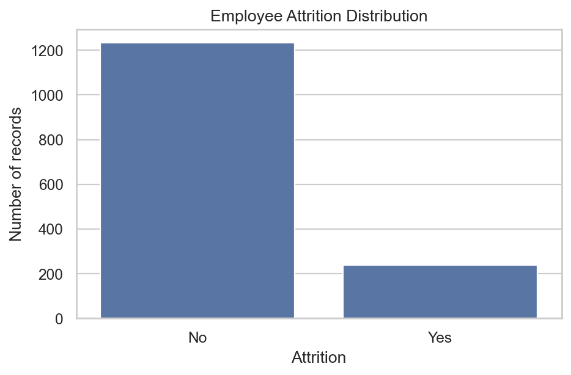
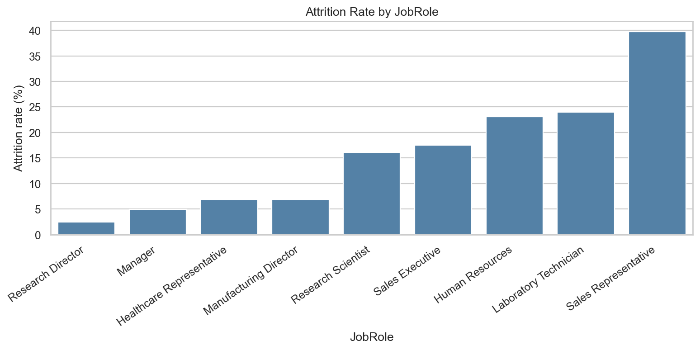
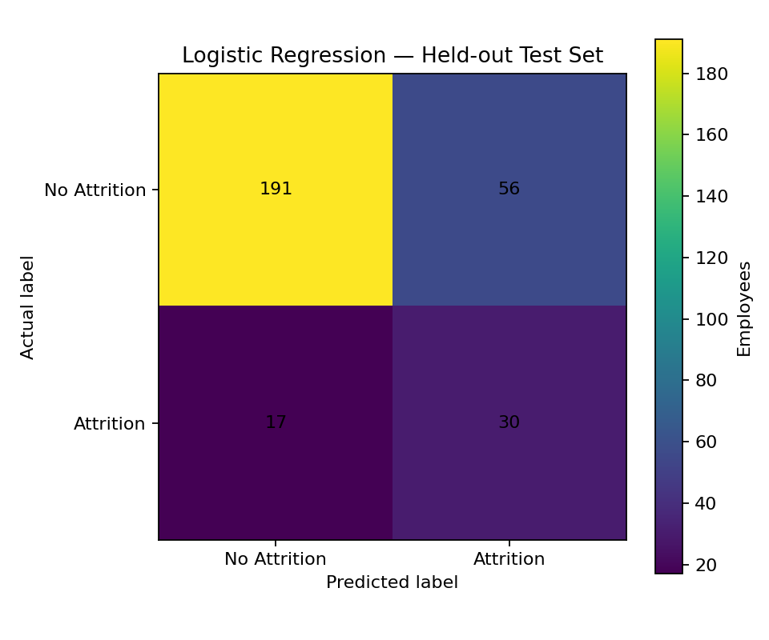
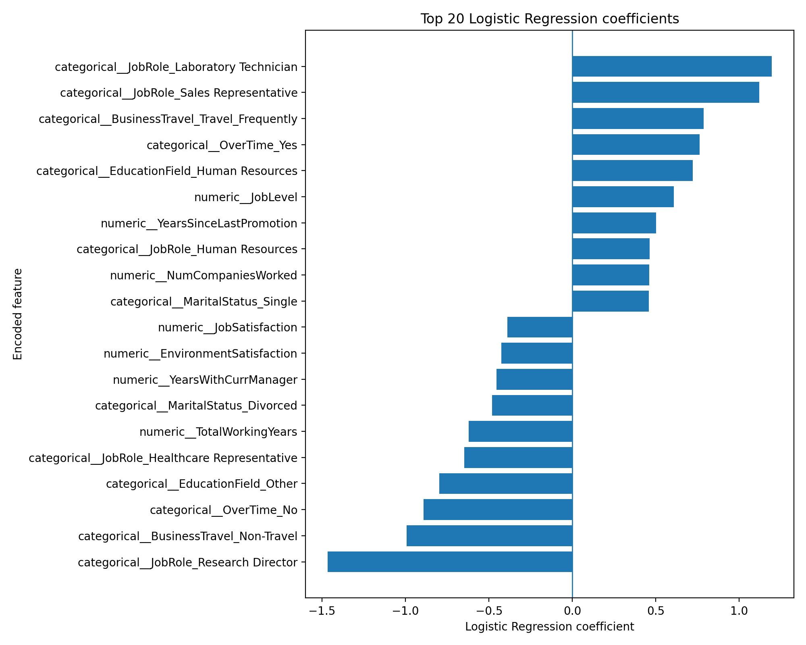

# Employee Attrition Analysis & Prediction

[](https://github.com/pranjali-sonkamble/employee-attrition-analysis/actions/workflows/ci.yml)

An end-to-end analytical prototype for understanding employee attrition patterns and evaluating a machine-learning model for attrition risk prediction using the IBM HR Analytics Employee Attrition & Performance benchmark dataset.

> **Project status:** Completed analytical portfolio prototype  
> **Primary focus:** EDA, model comparison, leakage-aware evaluation, threshold analysis, model interpretation, uncertainty, subgroup diagnostics, and reproducibility  
> **Important:** This is not a production HR decision system and must not be used as the sole basis for employment decisions.

---

## Project at a glance

| Item | Result |
|---|---:|
| Dataset | IBM HR Analytics Employee Attrition & Performance |
| Dataset shape | 1,470 rows × 35 columns |
| Modeling features | 30 |
| Training / test split | 1,176 / 294 |
| Selected model | Logistic Regression |
| Threshold used for final test | 0.50 |
| Test ROC-AUC | **0.8032** |
| Test Average Precision | **0.5612** |
| Test precision / recall | **0.3488 / 0.6383** |
| Bootstrap resamples | 2,000 |
| Regression tests | 10 passed (local run) |

The source dataset is a **fictional benchmark**. These findings are not claims about IBM's actual workforce or any real employer.

## Project overview

Employee attrition is a workforce analytics problem. This project explores which employee and job attributes are associated with the observed target and evaluates whether a classification model can rank records by predicted attrition risk.

The workflow deliberately separates development from final testing:

**Data validation → EDA → preprocessing → repeated cross-validation → OOF threshold analysis → fixed model and threshold → held-out test evaluation → bootstrap uncertainty → model interpretation → subgroup diagnostics → regression tests**

The held-out test set was not used for model comparison or threshold selection.

## Dataset and data quality

**Dataset:** [IBM HR Analytics Employee Attrition & Performance (Kaggle)](https://www.kaggle.com/datasets/pavansubhasht/ibm-hr-analytics-attrition-dataset)

Local inspection records 1,470 rows and 35 columns, with no missing values or duplicate rows. The target distribution is:

| Attrition | Records | Share |
|---|---:|---:|
| No | 1,233 | 83.88% |
| Yes | 237 | 16.12% |

`EmployeeNumber` is unique and treated as an identifier. `EmployeeCount`, `Over18`, and `StandardHours` are constant. Those four fields and the target are excluded from the 30 model input features.

The raw CSV is not committed. See [data/README.md](data/README.md) for download and placement instructions, and [docs/data_source.md](docs/data_source.md) for provenance and redistribution notes.

## Key business findings

> **The business story comes before the model.** The descriptive analysis identifies where observed attrition is concentrated; the model then evaluates whether those patterns can support a cautious risk-screening workflow.

| Finding | Observed result |
|---|---:|
| Overtime attrition | **30.53%** vs **10.44%** without overtime |
| Sales Representative attrition | **39.76%** |
| Early-tenure attrition | **25.96%** |
| Single-employee attrition | **25.53%** |
| Final test recall | **63.83%** |
| Final test precision | **34.88%** |
| Test false positives | **56 of 86 flagged records** |

These are descriptive or predictive results from a fictional benchmark dataset. They should not be interpreted as causal effects or evidence about a real employer.

## Portfolio visuals

### Attrition distribution



### Key segmentation: attrition by job role



### Model decision trade-off



The confusion matrix makes the operational trade-off explicit: the model catches 30 of 47 attrition cases, but 56 of the 86 flagged records are false positives.

### Model interpretation



The coefficient analysis is interpreted as conditional model association, not causation. Numeric features were standardized before modeling. One-hot encoding uses `drop=None`, so no category is explicitly removed as a reference level; categorical coefficients therefore require care and should not be described as effects relative to a manually chosen reference category.

## Exploratory analysis

The EDA examines attrition rates across work patterns, job roles, demographics, compensation, satisfaction, and tenure. A few descriptive findings from the local dataset:

- Attrition was 30.53% among records with overtime and 10.44% among those without overtime.
- Sales Representatives had an observed rate of 39.76% (83 records).
- Single employees had an observed rate of 25.53%.
- The age-band pattern was non-monotonic: 25.91% up to age 30, 16.02% at 31–36, 8.92% at 37–43, and 12.10% at 44–60.

These are descriptive associations, not causal effects. Group sizes differ and smaller groups require particular caution.

Details: [EDA findings](docs/eda_findings.md), [EDA summary](reports/eda_summary.txt), and [relationship summary](reports/relationship_summary.txt).

## Modeling and evaluation design

The modeling input contains 30 features grouped into 7 categorical fields, 8 coded ordinal fields retained as numeric, and 15 other numeric fields. The reusable pipeline performs median imputation and numeric scaling, most-frequent categorical imputation, and one-hot encoding. The selected Logistic Regression uses `class_weight="balanced"` to account for the imbalanced target. **SMOTE is disabled** because class weighting already addresses the class imbalance without creating synthetic observations, keeping the final training pipeline simpler and directly interpretable.

The data is split once using a stratified 80/20 split with random state 42:

- Training: 1,176 rows (190 attrition cases)
- Held-out test: 294 rows (47 attrition cases)

Candidate models were compared using repeated stratified five-fold cross-validation with three repeats on the training partition. Logistic Regression was selected on mean Average Precision and ROC-AUC:

| Model | CV Average Precision | CV ROC-AUC |
|---|---:|---:|
| Logistic Regression | **0.6130 ± 0.0065** | **0.8251 ± 0.0017** |
| Hist Gradient Boosting | 0.5472 ± 0.0162 | 0.8005 ± 0.0098 |
| Random Forest | 0.5460 ± 0.0091 | 0.8026 ± 0.0001 |
| Dummy baseline | 0.1616 ± 0.0000 | 0.5000 ± 0.0000 |

Threshold trade-offs were analyzed separately using training-set out-of-fold probabilities. The final test threshold was fixed at **0.50**; it was not selected from the held-out test labels.

## Final held-out test results

The Logistic Regression model was evaluated on the untouched 294-row test partition at threshold 0.50.

| Metric | Test result |
|---|---:|
| Average Precision | **0.5612** |
| ROC-AUC | **0.8032** |
| Precision | **0.3488** |
| Recall | **0.6383** |
| F1 score | **0.4511** |

Confusion matrix:

|  | Predicted No | Predicted Yes |
|---|---:|---:|
| **Actual No** | 191 | 56 |
| **Actual Yes** | 17 | 30 |

The model identified 30 of 47 attrition cases and missed 17. It flagged 86 records, of which 56 were false positives. This supports interpreting the model as a screening or ranking prototype, not a definitive predictor of an individual's intent.

Full detail: [final evaluation](docs/final_evaluation.md), [test metrics](reports/final_test_metrics.csv), and [confusion matrix](reports/final_test_confusion_matrix.csv).

## Uncertainty analysis

A bootstrap analysis used 2,000 valid resamples of the frozen test predictions (seed 42). Selected 95% percentile intervals:

| Metric | Estimate | 95% interval |
|---|---:|---:|
| Average Precision | 0.561 | 0.425–0.689 |
| ROC-AUC | 0.803 | 0.727–0.873 |
| Precision | 0.349 | 0.247–0.453 |
| Recall | 0.638 | 0.489–0.778 |

The bootstrap does not refit or tune the model; it quantifies sampling uncertainty around the fixed test predictions. [Full uncertainty table](reports/test_uncertainty.csv).

## Model interpretation

The final Logistic Regression model has 51 transformed features. Coefficients were calculated from a pipeline fitted on the training partition only. Numeric features were standardized, so numeric odds ratios correspond to a one-standard-deviation increase, not a one-unit raw change.

The largest positive associations included Laboratory Technician job role (coefficient 1.1943; odds ratio 3.3014), Sales Representative job role (1.1206; 3.0667), frequent business travel (0.7876; 2.1980), and overtime (0.7615; 2.1415). These are conditional model associations, not causal effects. Because the encoder retains all categories (`drop=None`) and the regularized model includes an intercept, individual categorical coefficients should not be read as simple causal effects or as comparisons against a manually selected reference category.

See [model interpretation](docs/model_interpretation.md) and [coefficient output](reports/model_interpretation.csv).

## Protected attributes

`Gender` and `Age` are retained in the analysis because they are available in the benchmark dataset and are useful for subgroup diagnostics and checking whether model performance differs across groups. They are not used to make or justify employment decisions. This project does **not** claim that retaining these attributes is appropriate for a real HR deployment. Removing protected attributes and comparing the resulting model has not been tested, so no claim is made that exclusion would improve or worsen model performance or fairness.

## Subgroup diagnostics

The frozen model was evaluated descriptively across gender and age groups at the same 0.50 threshold.

| Group | Rows | Attrition cases | Precision | Recall | False-positive rate |
|---|---:|---:|---:|---:|---:|
| Female | 116 | 16 | 0.324 | 0.688 | 0.230 |
| Male | 178 | 31 | 0.365 | 0.613 | 0.224 |
| Age 18–30 | 77 | 18 | 0.438 | 0.778 | 0.305 |
| Age 31–36 | 84 | 11 | 0.258 | 0.727 | 0.315 |
| Age 37–43 | 72 | 7 | 0.357 | 0.714 | 0.138 |
| Age 44+ | 61 | 11 | 0.333 | 0.273 | 0.120 |

Performance is not uniform, particularly across age bands. This small, single-split diagnostic does not establish fairness or discrimination; uncertainty and a predefined fairness framework would be needed for a formal assessment. See [subgroup evaluation](docs/subgroup_evaluation.md) and [CSV results](reports/subgroup_evaluation.csv).

## Responsible use and limitations

- The dataset is fictional and does not establish real-world employee behavior.
- Observational associations do not demonstrate causation.
- A single held-out split has limited sample size, especially for subgroup analysis.
- False positives are substantial at the fixed threshold.
- The model has not been calibrated or validated for production use.
- Organization-specific validation, privacy and access controls, fairness assessment, monitoring, governance, and human oversight would be prerequisites for any real application.

The model must not be the sole basis for hiring, termination, promotion, compensation, disciplinary, or other employment decisions.

## Reproducibility

The project was developed with Python 3.10. Package versions are pinned in `requirements-lock.txt`; the smaller `requirements.txt` lists the main direct dependencies. Place the raw CSV at the path documented in [data/README.md](data/README.md), activate the virtual environment, and run commands from the repository root.

Install dependencies:

```bash
pip install -r requirements-lock.txt
```

Run tests:

```bash
pytest -q
```

Run the main analysis stages:

```bash
python src/inspect_data.py
python src/validate_columns.py
python src/explore_data.py
python src/explore_relationships.py
python src/compare_models.py
python src/evaluate_thresholds.py
python src/final_evaluation.py
python src/test_uncertainty.py
python src/model_interpretation.py
python src/subgroup_evaluation.py
```

The latest recorded local test run passed all 10 regression tests. GitHub Actions runs the regression suite on pushes to `main` and pull requests using the pinned lock file on Ubuntu Linux.

## Repository structure

```text
employee-attrition-analysis/
├── data/
│   └── README.md
├── docs/
│   ├── data_source.md
│   ├── eda_findings.md
│   ├── final_evaluation.md
│   ├── model_interpretation.md
│   ├── project_charter.md
│   ├── subgroup_evaluation.md
│   └── threshold_evaluation.md
├── reports/
│   ├── figures/
│   ├── baseline_cv_results.csv
│   ├── categorical_attrition_rates.csv
│   ├── column_validation.txt
│   ├── data_inspection.txt
│   ├── eda_summary.txt
│   ├── final_test_confusion_matrix.csv
│   ├── final_test_metrics.csv
│   ├── model_comparison.csv
│   ├── model_comparison_repeats.csv
│   ├── model_interpretation.csv
│   ├── numeric_attrition_rates.csv
│   ├── preprocessing_summary.txt
│   ├── relationship_summary.txt
│   ├── split_summary.txt
│   ├── subgroup_evaluation.csv
│   ├── test_uncertainty.csv
│   └── threshold_evaluation.csv
├── src/
│   ├── compare_models.py
│   ├── data_prep.py
│   ├── evaluate_thresholds.py
│   ├── explore_data.py
│   ├── explore_relationships.py
│   ├── final_evaluation.py
│   ├── inspect_data.py
│   ├── model_interpretation.py
│   ├── model_zoo.py
│   ├── preprocessing.py
│   ├── subgroup_evaluation.py
│   ├── test_uncertainty.py
│   ├── train_models.py
│   └── validate_columns.py
├── tests/
│   └── test_data_pipeline.py
├── .gitignore
├── requirements-lock.txt
└── requirements.txt
```

## Business finding

The clearest actionable pattern in this benchmark is the concentration of observed attrition among overtime workers: **30.53% versus 10.44% without overtime**. Sales Representatives also show a **39.76%** observed attrition rate, while early-tenure employees show **25.96%**. These patterns can guide workforce-analysis questions, but they are not causal findings and cannot be transferred directly to a real employer.

## Key takeaway

The strongest part of this project is its evaluation discipline: model comparison and threshold analysis use training-set cross-validation, the final model and threshold are fixed before held-out testing, test uncertainty is quantified, coefficients are interpreted with scaling and correlation caveats, subgroup behavior is examined, and automated tests cover core pipeline behavior.
